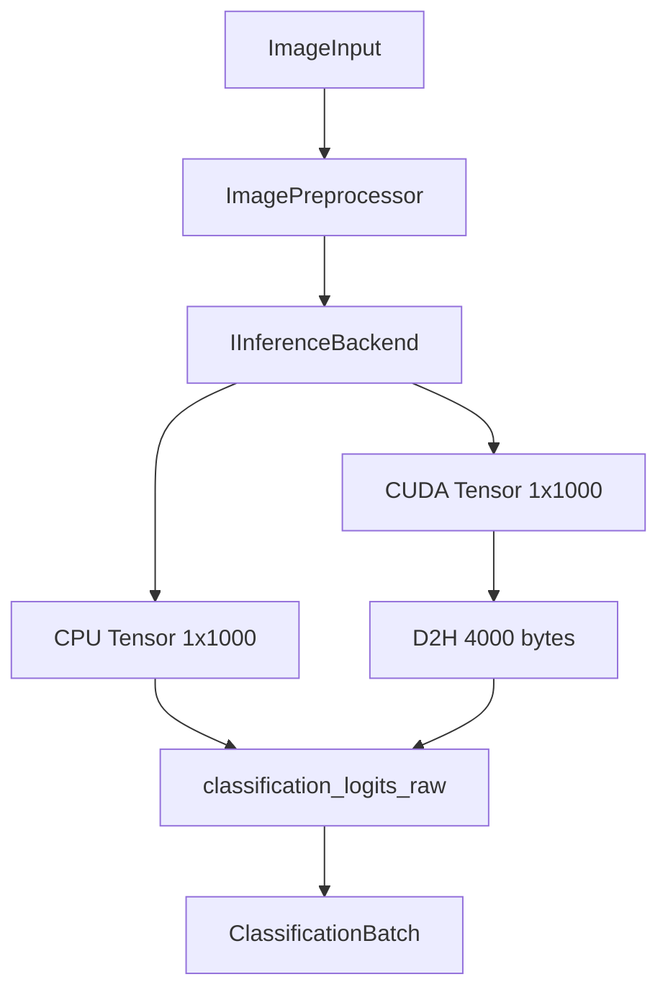

# Classification 架构评估

第 1–14 节是 Phase 6.1 的接入设计，写于实现之前。Phase 6.2 的实际行为和测量见第 15 节。

研究对象是本机临时导出的 `/tmp/resnet50_untrained_static.onnx`，不是仓库里的 testdata，也不是 ImageNet 权重文件。导出命令使用已安装的 PyTorch 2.14.1 与 torchvision 0.29.2：`resnet50(weights=None)`，legacy TorchScript 导出（`dynamo=False`），opset 17，输入名 `input`，输出名 `logits`，静态张量 `[1,3,224,224]`。文件 102057667 字节。权重是模块的默认初始化。这次执行只证明算子图能跑，不能证明分类正确。

## 1. 当前架构

调用链是固定的三段，任务差异放在 Decoder 和结果类型上：

```text
ImageInput
  -> ImagePreprocessor（Manifest 的颜色、resize、归一化）
  -> IInferenceBackend::execute（具名 Tensor，不知道任务）
  -> IModelDecoder（按 protocol 注册）
  -> DetectionBatch 或 SegmentationBatch
```

`TaskType` 已经有 `Classification`，JSON 字符串是 `classification`。`task_needs_box_format()` 对它返回 false，`task_needs_num_classes()` 对除 `Unknown` 以外的任务返回 true。枚举先于管线存在。

`InferenceEngine::load()` 按 `decoder.protocol` 创建 Decoder，按 `model_format` 和设备创建 Backend。它不按 `model_family` 选 Decoder。`infer()` 只在 `task == Segmentation` 时拒绝，然后调用 `decode_batch()`。`infer_segmentation()` 要求 `task == Segmentation` 且 protocol 为 `yolov8_seg_raw`。

`IModelDecoder` 的纯虚函数仍是 `decode()`，返回带框的 `RawPredictions`。`decode_batch()` 和 `decode_segmentation()` 有默认实现，分别抛出 “does not produce detections” 和 “does not produce instance segmentation”。RT-DETR 的注册对象 `RtdetrDetectionDecoder` 按设备把同一次 `decode_batch()` 转给 CPU 或 CUDA 实现，`infer()` 里没有 family 分支。

Manifest schema 仍是 `1.0`。通用字段是名称、任务、格式、输入、输出、`num_classes` 和 provenance。检测字段集中在 `decoder` 与 `nms`：框格式、DFL、query 数、阈值、IoU。分割字段在可选对象 `segmentation` 里，未使用时 JSON 不出现这个键。`num_queries` 也是未设置时省略。这是已经用过的兼容扩展方式。

Preprocessor 能做 RGB/BGR、NCHW/NHWC、stretch、letterbox、nearest、bilinear，以及四种归一化词：`none`、`scale_1_255`、`scale_0_1`、`imagenet`。`imagenet` 在代码里是先除以 255，再减 `(0.485, 0.456, 0.406)`，除以 `(0.229, 0.224, 0.225)`。Manifest 里的 `crop` 是合法词，执行时返回 Unsupported。没有 center crop，也没有短边 resize 后再裁的参数。

## 2. ResNet-50 ONNX

分析使用现有 `OnnxAnalyzer` 和 `vie_analyze_onnx`。执行使用现有 `OnnxRuntimeBackend` 与 `OnnxRuntimeCudaBackend`，没有新的 Parser。

| 项 | 图上的事实 |
|---|---|
| producer | pytorch 2.14.1 |
| opset | ai.onnx 17，IR 8 |
| metadata | 0 条 |
| 输入 | 一个，`input`，float，声明 `[1, 3, 224, 224]` |
| 输出 | 一个，`logits`，float，声明 `[1, 1000]` |
| 动态轴 | 无。batch、通道、高、宽、类别轴都是静态数 |
| 节点 | 169 |
| 算子 | Conv 53，Relu 49，Identity 47，Add 16，MaxPool 1，GlobalAveragePool 1，Flatten 1，Gemm 1 |
| Softmax | 0 |
| Sigmoid | 0 |

输出生产者就是 `/fc/Gemm`，没有包在 Identity 里。Gemm 的输入是 Flatten 结果、`fc.weight` `[1000, 2048]`、`fc.bias` `[1000]`，`transB=1`。Flatten 的 `axis=1`，其输入是 `GlobalAveragePool`。因此这个输出是 2048 维池化向量经过一个 1000 维线性层，结果形状 `[1, 1000]`。图没有在线性层之后做 Softmax 或 Sigmoid。

现有三个 Recognizer 的结果是 `unknown`，说明是 “no recognizer accepted this graph”。

执行：

- CPU 包 1.20.1 的 CPU EP：`prepare` 与 `execute` 成功。输出在 CPU，shape `[1, 1000]`，fp32，lifetime `copied`。全零输入的第一个元素是有限值。
- GPU 包 1.20.1 里的 CPU EP：同样成功，输出在 CPU。
- CUDA EP：`cpu_ep_fallback` 默认是 0。`prepare` 成功，说明这张图被严格 CUDA EP 接受。输出在 `cuda:0`，shape `[1, 1000]`，fp32，lifetime `copied`，`cudaPointerGetAttributes` 的 type 为 2，nbytes 为 4000。

这些名字里，`input` 和 `logits` 是导出时指定的，不是图结构必然的名字。`/fc/Gemm` 和 `fc.weight` 来自 torchvision 模块。1000 与 2048 是这份权重形状，只能说明线性层的输出宽度，不能说明这些下标是 ImageNet 类别。文件没有类别名、颜色、resize 或归一化。

未验证的部分：

- 没有下载 ImageNet 权重，因此没有准确率、top-1 类别或与官方预处理的像素差。
- 没有跑 dynamo 导出。换导出器以后，Identity 数量和节点名可能变。
- 没有把预处理配方写进图。torchvision 文档里的 resize 256 或 232、center crop 224、RGB 和那组 mean/std，是外部配方，不是这次 ONNX 的观测。
- 全零输入只能证明算子可执行。它不是一张图片。

## 3. 当前限制

`infer()` 的返回类型把非分割任务都送进 `decode_batch()`。`TaskType::Classification` 今天不会在入口被拒绝。随后 `decoder_config_from_manifest()` 会要求框解码字段。分类模型会被当成缺字段的检测模型，而不是另一种结果。

`decode()` 的 `RawPredictions` 带框。分类没有框。把它塞进 `Detection` 会伪造 bbox，并使 `query_index`、NMS 和 `GeometryTransform` 出现在不适用的结果上。

`DecoderConfig`、`nms` 和 `decoder.scores_are_probabilities` 的语义是检测头或分割头。分类的 “logits 还是 probabilities” 不能复用这个字段，否则一份 Manifest 会同时像检测又像分类。

`segmentation` 已经演示了可选任务对象。分类若把自己的字段摊进 `decoder` 和 `nms`，现有检测 Manifest 的含义会被带偏。

图像入口不能表达 torchvision 的短边缩放加中心裁剪。`crop` 这个词存在，但执行直接 Unsupported。`imagenet` 只固定了一组 mean/std，不能表达别的分类模型自己的均值。图本身也不包含这组数。

Recognizer 的规则是证据条数，文件名不参与。单输入、单输出、`[1,1000]` 和最后一层 Gemm 同时成立，仍可以是 embedding 之后的任意线性层、回归头或未标注的特征。现在返回 Unknown 是正确行为。

Backend 不需要知道任务。CPU EP 和严格 CUDA EP 都能交出这份 `[1,1000]`。分类要补的是结果类型、协议和解码，不是新的 Execution Provider。

## 4. 结果结构

分类不是检测的特例。结果里没有框，也不做坐标映射。

建议的业务对象：

```cpp
enum class ClassificationScoreKind { Logits, Probabilities };

struct Classification {
  int class_id = -1;
  float score = 0.f;
};

struct ClassificationResult {
  std::vector<Classification> labels;
  ClassificationScoreKind score_kind = ClassificationScoreKind::Logits;
  int num_classes = 0;
  std::string output_name;
  std::string protocol;
  DeviceType execution_device = DeviceType::Cpu;
  int execution_device_id = 0;
  std::size_t d2h_bytes = 0;
};

struct ClassificationBatch {
  std::vector<ClassificationResult> results;
};
```

`class_id` 是输出轴上的下标，从 0 开始。没有类别名时不发明名字。名称表如果存在，长度必须等于 `num_classes`，放在 Manifest 里，由调用方按 `class_id` 查找。它不是每条结果的副本。

语义约定：

1. Top-1 是 Top-K 在 K=1 时的结果。K 来自当次运行配置，不写回 Manifest。
2. 图内没有 Softmax 时，张量是 logits。Decoder 默认不改变这个含义，`score_kind` 为 `Logits`。
3. 只有运行配置明确要求概率，并且 Manifest 记录图内没有 Softmax 时，才做一次 softmax。图内已经有 Softmax 时再做一次，返回 Unsupported。
4. 多标签不在第一版。请求 sigmoid 或多标签时返回 Unsupported。一个没有激活的 Gemm 不能区分互斥类别和多标签。
5. 类别名只在 metadata 或用户字段的数量与类别维一致时写入。不一致就保持 unresolved。
6. 排序是分数降序。分数相同则 `class_id` 升序。这是全序，结果确定。
7. 任一 logits 为 NaN 或 Inf，整次解码返回 InvalidArgument，不丢掉该类别。
8. rank 不是 2、batch 不是 1、类别维与 `num_classes` 不一致、输出名缺失，都是 InvalidArgument。
9. 空输出不是合法的分类结果。类别维至少为 2，避免把单值回归当成分类。
10. `top_k` 小于 1 为 InvalidArgument。大于类别数时返回全部类别，顺序仍按上面的规则。
11. CPU 与 CUDA EP 的比较对象是同一解码规则。EP 之间的 logits 可以有数值差，比较时要有声明过的容差。未训练权重不能用来验收类别是否正确。
12. `[1,1000]` fp32 是 1000 个元素、4000 字节。第一版把这 4000 字节 D2H，再在 CPU 上排序。这是完整分数向量，不是检测那种大张量。`d2h_bytes` 记录这 4000，不把元素数写成字节数。

`GeometryTransform` 不参与分类解码。预处理如果将来做了裁剪，几何信息仍可留给别的任务，分类结果不保存框。

## 5. Decoder API

在 `IModelDecoder` 上增加一个带默认实现的虚函数：

```cpp
virtual ClassificationBatch decode_classification(
    const DecoderInput& input, const DecoderConfig& config,
    const DeviceContext& device) const;
```

默认实现抛出 Unsupported，消息表明这个 Decoder 不产生分类。现有检测和分割 Decoder 不用改函数体。`decode()` 对分类协议继续抛出 Unsupported，避免把类别写进 `RawDetection`。

协议名建议 `classification_logits_raw`。它表示：一个 rank-2 的 fp32 向量，最后一维是类别，图内没有把 logits 变成概率。Registry 仍是一个协议一个工厂。

第一版只有 CPU 算法。CUDA 张量先把这 4000 字节拷到 Host，再执行同一算法。这是传输，不是 CUDA Kernel 失败后的回退。以后若增加 CUDA Top-K，再按 RT-DETR 的方式用一个注册对象按设备转发，并禁止失败后改走另一条算法。

`DecoderConfig` 可以增加分类专用的可选字段，例如输出名、类别轴、`score_kind` 和 `top_k`。检测 Decoder 不读这些字段。不要把分类的 softmax 开关塞进 `box_decode` 或 `nms`。

## 6. InferenceEngine API

保留 `infer()` 为检测入口，保留 `infer_segmentation()` 为分割入口。增加：

```cpp
ClassificationBatch infer_classification(
    const ImageInput& image,
    const ClassificationRuntimeConfig& runtime,
    ClassificationInferTiming* timing = nullptr);
```

`ClassificationRuntimeConfig` 只有当次调用的 `top_k`，以及是否把 logits 变成概率。它不写回 Manifest。

入口检查：

- `infer()` 在 task 为 Segmentation 或 Classification 时返回 Unsupported。
- `infer_classification()` 要求 task 为 Classification，且 protocol 为 `classification_logits_raw`。
- 选 Backend 和选 Decoder 的代码继续用现有 `load()`。不在 Engine 里按 family 写 ResNet、YOLO 或 RT-DETR 分支。
- 设备校验、未加载、缺输出名，沿用现有错误。
- 计时字段与 `DetectionInferTiming` 相同：preprocess、execute、decode、total，以及 CUDA 上是否包含同步和 D2H。调用方自己的 H2D 仍在计时之外。

不增加 `infer_result()`。现有两个入口已经按结果类型分开。第三个任务再加一个入口，调用点的类型是明确的。一个返回 variant 的总入口不会减少这三次检查，只会让每个调用方再做一次类型判断。

`execute()` 保持只返回具名 Tensor。分类模型即使还没有图像预处理，也可以先用 Tensor 入口验证 Backend。

## 7. Manifest

保持 schema `1.0`。增加可选对象 `classification`，规则与 `segmentation` 相同：所有字段都处于空状态时，JSON 不出现这个键，provenance 也不出现对应路径。已有 YOLO 和 RT-DETR 文档的往返结果应保持不变。

建议字段：

| 字段 | 含义 | 这份 ResNet 能否从图得到 |
|---|---|---|
| `output_name` | 要解码的那个输出 | 导出时只有一个输出，名字是导出参数 |
| `class_axis` | 类别所在轴，rank-2 时为 1 | 能。Gemm 输出的最后一维 |
| `activation` | `logits` 或 `probabilities` | 能证明没有 Softmax，因此是 logits |
| `class_names` | 可选名称 | 不能。metadata 为空 |

`num_classes` 继续用现有字段。它必须等于类别轴长度。`decoder.protocol` 使用新协议。`decoder.box_format`、`box_decode`、`nms` 对这个任务保持未设置，validator 对 Classification 继续不要求框格式。

不从 shape `[1,1000]` 推断 ImageNet，也不把 `model_family` 写成 `resnet`，除非以后的 Recognizer 证明了 ResNet 的卷积结构。用户可以另交一份运行时 Manifest，用 `user` provenance 写明 RGB、`imagenet` 归一化和尚未实现的裁剪。这些值不能回写成图的事实。

多个分类头：图上有多个 rank-2 浮点输出时，Recognizer 保持 Unknown。用户若要加载，必须显式写出唯一的 `output_name`。第一版协议只接受恰好一个被声明的分类输出，其余输出返回 Unsupported，避免静默丢掉一个头。

logits 与概率靠 `classification.activation` 表达。检测用的 `decoder.scores_are_probabilities` 不参与这条协议。

## 8. Recognizer

值得增加一个很窄的识别器，但不在解码器完成之前靠它加载模型。识别失败必须保持 Unknown。

必要证据，全部成立才接受：

- 恰好一个 float 运行时输入，rank 4，某个轴是静态 3。
- 恰好一个 float 运行时输出，rank 2。一个轴是静态 1 或符号 batch，另一个轴是静态整数且不小于 2。
- 顺着输出向前，只允许 Identity，然后是 Gemm 或 MatMul。
- 该线性层的类别维等于输出的类别维。
- 从输出到这个线性层之间没有 Softmax 和 Sigmoid。
- 线性层的数据输入能追到 GlobalAveragePool 或等价的全局归约。

辅助证据，只能写进 evidence，不能单独促成识别：类别维是 1000、池化前有 Conv、权重名里有 `fc`。文件名不使用。

必须保持 unresolved：颜色、resize、归一化、类别名、是否 ImageNet、用户是否想要概率。`activation=logits` 是图内没有 Softmax 的推断，不是数据集标签。

保持 Unknown 的图：

- 多个输出，或输出 rank 不是 2。
- 类别维小于 2，或类别维是动态的。
- 没有线性分类层的特征提取和 embedding。
- 输出 rank 3 的 token 分类。
- 已经带检测、分割、TopK 或 NMS 结构、会被现有识别器接受的图。
- 只有 Softmax 没有可核对的线性层。
- 线性层之后还有任务头。

因此不建议第一版就叫 `ResNetClassificationRecognizer`。ResNet-50 的 7×7 stem 和四段残差要单独证明。窄识别器只应给出协议 `classification_logits_raw` 和类别数，family 可以是 `cnn_classifier`。它不能把 embedding、回归和多任务模型收进来。

## 9. Preprocess

图只约束输入是 float、`[1,3,224,224]`。它不约束 RGB 还是 BGR，也不约束像素怎么变成这个张量。

现有能力够用的部分：NCHW、RGB/BGR 对调、fp32、除以 255、以及名为 `imagenet` 的那组 mean/std。最后一项只是 VIE 词表里的一个固定配方。别的分类模型可以有别的均值，Manifest 现在写不进去，虽然 `PreprocessConfig` 的 `mean` 和 `std` 向量已经能表达。

不够用的部分是几何。torchvision 文档中的配方是先把短边缩放到 256 或 232，再中心裁成 224。stretch 会改变长宽比，letterbox 会引入边。二者都不是该配方。`crop` 还不能执行。

建议把图像预处理分成两步接入：Tensor `execute()` 可以先验证模型；`infer_classification()` 的图像入口在 center crop 落地前，对 `resize=crop` 继续 Unsupported，不把 stretch 悄悄当成分类默认值。center crop 需要新的 resize 词和新的短边长度，仍应是可选字段。不要假定每个分类模型都用 ImageNet mean/std。

## 10. CPU 与 CUDA

Backend 可以直接复用。这份图在 CPU 包的 CPU EP、GPU 包的 CPU EP，以及关闭 fallback 的 CUDA EP 上都能执行。CUDA 输出已经是 VIE 的设备 Tensor，4000 字节。

两种解码：

| 方案 | 数据移动 | 计算 |
|---|---|---|
| A. GPU Top-K | 只拷 K 条结果 | 一次 kernel、排序和同步 |
| B. 整段 D2H 后 CPU Top-K | 4000 字节 | 1000 次比较，CPU 上可以忽略 |

1000 类、batch 1 时，4000 字节小于一次 kernel 启动加同步的代价。RT-DETR 的 300 个 query 已经测过：GPU 排序的端到端时间高于 CPU。分类向量更小。第一版采用 B。`d2h_bytes` 就是这个向量的字节数。CUDA Top-K 等到类别维大到传输本身成为主体，或者 batch 远大于 1 时再评估。不把 “有 CUDA Tensor” 当成 “必须写 CUDA Decoder”。

## 11. 三种方案

### A. 独立 Classification API

新增 `ClassificationBatch`、`decode_classification()` 和 `infer_classification()`。检测与分割的函数签名不变。

- API 复杂度低。调用方从函数名知道结果类型。
- 类型安全高。不需要从 variant 里取出。
- 兼容性好。现有虚函数保留，新虚函数有默认实现。
- CPU 路径直接实现。CUDA 先做明确的小块 D2H。以后的设备转发可以照 RT-DETR。
- Pose 和 OBB 仍是带框任务，以后可以留在检测结果或再加自己的入口。分类这个决定不强迫它们进同一个类型。
- 对现有 Decoder 的侵入是一个默认虚函数和 `infer()` 的一道任务拒绝。

### B. 统一 `InferenceResult` 加 variant

`infer_result()` 返回 `std::variant<DetectionBatch, SegmentationBatch, ClassificationBatch>`。

- 多一个总入口，原有 `infer()` 仍要保留，否则所有检测调用都会改。
- 类型安全依赖调用方访问正确的备选项，用错会在运行时暴露。
- 每加 Pose、OBB 就改 variant，所有访问点一起改。
- 它没有去掉 Engine 里的任务检查，只是把检查从三个函数收成一个函数内部的分支。
- 现有分割已经说明不同结果不共享一个返回类型。variant 解决的是 “一个变量保存任意任务”，当前没有这个调用场景。

### C. 继承或模板结果

`Result<T>` 或一个带虚函数的 `InferenceResult` 基类。

- 模板会进入公共头文件，增加实例化和 ABI 的表面积。
- 基类指针会抹掉 `DetectionBatch` 与 `SegmentationBatch` 今天的值语义。
- 检测、分割、分类的字段交集只有设备、协议和计时。为这个交集做基类，业务字段仍要向下转型。
- Pose 可以继承检测，但分类不能继承检测。基类因此帮不上分类与检测的差异。
- 现有具体结构会被包进模板或改成多态，侵入最大。

推荐 A。B 和 C 留到真的出现 “同一调用点必须接收未知任务” 时再评估。分类这一次用独立结果就能接入，而且和 `infer_segmentation()` 的做法一致。

## 12. 推荐的数据流



`load()` 仍按 protocol 创建 Decoder，按设备和格式创建 Backend。`infer()` 与 `infer_segmentation()` 不进入这条结果。CUDA EP 保持禁止 CPU fallback。Decoder 不根据 family 选择。

## 13. 后续阶段

Phase 6.2，可以实施的最小闭环：

1. schema 1.0 增加可省略的 `classification` 对象。为现有 Manifest 增加往返测试，确认 JSON 不变。
2. 增加 `ClassificationBatch` 和默认拒绝的 `decode_classification()`。
3. 实现 CPU 协议 `classification_logits_raw`：有限值检查、可选的一次 softmax、稳定 Top-K。不做 NMS，不产生框。
4. `infer_classification()` 接入。`infer()` 拒绝 Classification。
5. 用用户 provenance 写这份静态导出的运行时 Manifest。Recognizer 仍返回 Unknown。
6. 测试 CPU EP 与严格 CUDA EP。CUDA 路径的 D2H 必须是 4000 字节，输出 Tensor 在拷贝前位于 CUDA。
7. 不实现 CUDA Top-K，不实现 center crop，不把未训练输出说成 ImageNet 结果。

Phase 6.3：窄识别器。只在第 8 节的必要证据全部成立时给出协议和类别数。多输出、embedding、token 分类和回归保持 Unknown。

Phase 6.4：短边缩放和 center crop，以及 Manifest 里可选的短边长度。图像入口在此之前不能声称复现 torchvision 预处理。是否允许任意 mean/std，而不是只有 `imagenet` 这个词，也在这一阶段决定。

Pose 与 OBB 继续用框任务的扩展点。它们不决定分类要不要 variant。CUDA Top-K 不排进 6.2。类别维或 batch 变大以后再单独评估。

## 14. 风险和未决问题

- 新虚函数对进程外插件是 ABI 变化。仓库内的 Decoder 靠默认实现保持可编译。
- `classification` 对象只要漏掉 “未使用则省略”，就会改变旧 Manifest 的 JSON。6.2 必须有往返测试。
- 这份 ONNX 的输出名是导出参数。别的 ResNet 导出可以叫 `output`。协议按 Manifest 的输出名读取，不把 `logits` 写死。
- 未训练权重的 Top-K 没有类别意义。正确性测试要用手写 logits，并和独立的标量参考比较。
- softmax 必须用稳定算法。是否暴露概率由运行配置决定，不能因为向量像概率就跳过检查。
- 图内 Softmax 的模型这次没有覆盖。那种图的 `activation` 应是 probabilities，再 softmax 必须失败。
- 多头、多标签、动态 batch、fp16 都不在第一版。动态 batch 现在会在 Manifest 的具体 shape 检查处被拒绝。
- center crop 未实现。用 stretch 跑图像会得到可执行但与 torchvision 配方不同的输入。
- `imagenet` 词表不能代表所有分类模型。
- GPU 包里的 CPU EP 与 CPU 包不是同一次链接。两边这次都能执行这张图。换模型时仍要分别验证。
- dynamo 导出的图没有分析。不能把这次 169 个节点当成所有 ResNet-50 ONNX 的节点数。

## 15. Phase 6.2 实现记录

第一版按独立结果落地，没有 `InferenceResult`。`infer()` 和 `infer_segmentation()` 的签名未改。新增 `Classification`、`ClassificationResult`、`ClassificationBatch`、`ClassificationDecoder` 和 `infer_classification()`。协议名是 `classification_logits_raw`。

和设计稿不一致、以本阶段规格为准的地方：

- Manifest 字段是 `score_type`，取值 `logits` 或 `probabilities`。第一版 Decoder 只执行 `logits`，不跑 Softmax。`probabilities` 可以保存，执行时返回 `Unsupported`。
- `top_k` 小于 1，或大于类别数，返回 `InvalidArgument`，不截断也不改成全部类别。
- 非有限 logit 返回 `InvalidArgument`，信息包含输出名、`class_id` 和 NaN 或 infinite。
- 分类字段的必填检查只在 protocol 为 `classification_logits_raw` 时生效。任务写成 classification、protocol 仍是 mock 的旧执行测试继续走 `run()`，`infer()` 对这个任务返回 `Unsupported`。

`classification` 对象在未使用时不写入 JSON。Detection 和 Segmentation 的序列化测试确认没有这个键。类别数继续用已有的 `num_classes`。输出 shape 不会被填成 ImageNet 语义。

CPU EP 的 logits 留在 CPU 上，`d2h_bytes` 为 0。严格 CUDA EP 先得到 CUDA 上的 FP32 输出，再由引擎把整条向量拷到 CPU，然后 CPU Decoder 做 Top-K。`[1,1000]` FP32 的显式 D2H 是 4000 字节。ORT 创建输出时自己的拷贝不计入这个数。结果的执行设备是 CPU。

真实模型是 `/tmp/resnet50_untrained_static.onnx`，`weights=None`，没有放进仓库。测试图像是 16×16 的零值，预处理是 stretch 和 `scale_0_1`，不是 torchvision 的短边缩放加 center crop。下表是一次 warmup 之后的一次调用，只记录链路，不比较 CPU 和 CUDA 的快慢，也不把类别下标解释成 ImageNet 预测。三条路径的 Top-1 下标相同，这只说明同一份输入走过了解码。

| 路径 | execute | logits D2H | D2H 字节 | CPU Top-K | 解码合计 | 输出字节 |
|---|---:|---:|---:|---:|---:|---:|
| CPU 包 CPU EP | 12.126 ms | 0 ms | 0 | 0.241 ms | 0.241 ms | 4000 |
| GPU 包 CPU EP | 14.568 ms | 0 ms | 0 | 0.056 ms | 0.056 ms | 4000 |
| GPU 包严格 CUDA EP | 2.182 ms | 0.052 ms | 4000 | 0.045 ms | 0.097 ms | 4000 |

四种构建都重新跑过：CUDA OFF + ORT OFF 105/105，CUDA OFF + ORT CPU 125/125，CUDA ON + ORT CPU 156/156，CUDA ON + ORT GPU 166/166。Detection、Segmentation 和 RT-DETR 的原有测试包含在这些数字里。

本阶段没有做分类 Recognizer、CUDA Top-K、多标签、center crop，也没有开始 Phase 6.3。

## 16. Phase 6.3 实现记录

`ClassificationRecognizer` 的 id 是 `classification_logits`，architecture 是 `single_label_classification`。它只读 `ModelAnalysisReport`。文件名、路径、框架和推理结果都不参与。

全部成立才接受：

- 一个 FP32 运行时输入，一个 FP32 输出。
- 输出声明为 rank 2。类别轴是最后一维，静态且不小于 2。另一维是静态 1、符号 batch，或未命名动态轴。两个维度都是不小于 2 的静态数时不识别。类别轴在前面的布局这一版不识别，因为 Gemm 的行维不能从权重形状证明。
- 从输出往回，只经过 Identity、Flatten、Reshape、Squeeze、Unsqueeze、Dropout、Cast、Transpose，可以有一次与 initializer 相加的 bias，然后必须是 Gemm 或 MatMul。
- 权重是第二个输入上的 initializer。Gemm 按 `transB` 取列数 N，MatMul 取权重最后一维。N 必须等于输出类别数。
- 线性层的数据输入只经过上述直通算子就能到达 `GlobalAveragePool` 或 `GlobalMaxPool`。
- 这条路径上没有 Softmax、Sigmoid、LpNormalization 或其他改变输出语义的算子。

`ReduceMean` 的 axes 是整数列表，当前报告只保存标量整数属性，所以这一版不把 ReduceMean 当成全局池化。

Evidence 都来自上面的图结构，没有数值 confidence：

| code | 来源 |
|---|---|
| `single_runtime_input` | 运行时输入的名字、dtype、声明 shape |
| `single_output` | 输出的名字、dtype、声明 shape |
| `rank2_output` | 声明 rank 与 shape |
| `class_dimension` | 最后一维的静态长度 |
| `batch_dimension` | 另一维是 1、符号或动态 |
| `linear_classification_head` | Gemm/MatMul 权重名、shape、`transB` |
| `global_pool_path` | 全局池化输出名和中间直通算子 |
| `logits_output` | 线性头到图输出之间没有激活 |
| `single_label_output` | 图只声明这一个输出 |

图里有 `Conv` 时 family 写成 `cnn_classifier`。没有 Conv 时 family 留空。不写 ResNet，也不因为类别数是 1000 写 ImageNet。

ManifestGenerator 在识别成功后填写 task、protocol `classification_logits_raw`、`num_classes`、`classification.output_name`、`classification.class_axis`、`classification.score_type=logits`。输入最后一维以外的轴 1 为静态 3 时，layout 记为 NCHW。颜色、归一化、resize、interpolation 和 `class_names` 保持未填写。生成的 Manifest 因此 schema 合法，但在调用者补上预处理之前不能 `infer_classification()`。

Registry 在分类候选和 Detection、Segmentation 或 RT-DETR 候选同时出现时返回 Ambiguous，不按 Evidence 条数让分类获胜。

负向 fixture 保持 Unknown：只有全局池化、Gemm 不经过池化、MatMul 不经过池化、类别数小于 2、rank 不是 2、Softmax、Sigmoid、LpNormalization、多输入、多输出。YOLOv8 Detection、YOLOv8 Segmentation、RT-DETR 仍由原来的识别器选中，生成的 JSON 没有 `classification` 键。

`/tmp/resnet50_untrained_static.onnx` 被识别为 `cnn_classifier`，输出 `logits`，类别轴 1，1000 类，`score_type=logits`。测试在生成结果之外补了 stretch 和 `scale_0_1`，再调用 `infer_classification()`。这不是自动预处理，也不是 ImageNet 预测。CPU EP 的 `d2h_bytes` 为 0，严格 CUDA EP 为 4000。

没有实现 center crop、类别名、Softmax Decoder、多标签和 CUDA Top-K。没有开始 Phase 6.4。

## 17. Phase 6.4 实现记录

预处理仍是公共的 `PreprocessConfig` 和 `ImagePreprocessor`。新增 `ResizeMode::ShortestSide`。配置字段是 `short_side`、`crop_width`、`crop_height`，并且 `target_width`、`target_height` 必须等于裁剪尺寸。Stretch 和 Letterbox 的几何与像素路径保持原样。旧 Manifest 词 `crop` 仍然返回 Unsupported。

顺序是：颜色通道对调、短边缩放、中心裁剪、`y = (x * scale - mean) / std`、布局转换。uint8 先变成 0..255 的 float，float32 使用存储值。公式只执行一次。mean 和 std 各 3 个数，对应输出通道。std 为 0 或长度不对时返回 InvalidArgument。`imagenet` 仍是调用者写明的命名配方，识别器不会填写它。

短边钉成 `short_side`。长边用整数公式 `(2 * long * short_side + short) / (2 * short)`，正数的一半远离 0。宽高比只在这一像素取整上产生 `scale_x` 与 `scale_y` 的差别。裁剪不能大于缩放后的图像，也不能大于 `short_side`；越界返回 InvalidArgument，不补边、不拉伸。奇数余数用整数除法：`crop_x = (resized_width - crop_width) / 2`，多出的像素在右侧和下侧。

采样公式仍是 `source = (content + 0.5) * (source / resized) - 0.5`。最近邻是 `floor(source + 0.5)`，负数一半远离 0，边界复制。双线性用 `floor` 和边界复制。CPU 与一份按这个公式写的独立采样器逐像素一致。这不是 torchvision 的通用兼容声明。用 torchvision 0.29.2、`antialias=False` 核对过：

- 7×5、短边 4：VIE 得到 6×4，torchvision 向 0 截断得到 5×4。
- 640×480、短边 256：两边都是 341×256。
- 2×1 升到短边 2 的双线性四个采样，两边都是 0、2.5、7.5、10。
- 6×4 裁 3×3：VIE 起点是 (1, 0)，torchvision 的 `round` 对 1.5 取偶数，起点是 (2, 0)。

`GeometryTransform` 增加 `crop_x`、`crop_y`。Letterbox 的 `pad_*` 不变，裁剪模式的 pad 为 0，`resized_*` 是裁剪前的尺寸。统一原点是 `pad_left - crop_x`。原图坐标是 `(x_model - origin) / scale`。检测、分割和 RT-DETR 的映射改用这个原点；`crop` 为 0 时与原来的 pad 公式相同。

Manifest 仍是 schema 1.0。未设置时不写出新键，Detection 和 Segmentation 的 JSON 不增加 `short_side` 或 `mean`。`resize=shortest_side` 要求 `short_side`、`crop_width`、`crop_height`，并且具体输入 shape 的高宽等于裁剪。`normalization=explicit` 要求 `scale`、三项 `mean`、三项非 0 的 `std`。缺字段时不可执行。这些字段由调用者以 `user` provenance 填写。识别器看到 ResNet 结构时仍不写颜色、短边或 mean/std。

CUDA 复用原来的单 kernel。Host 把原点 `pad_left - crop_x` 传进去，采样公式不变。7×5、短边 6、裁成 4×3、BGR 转 RGB、explicit 归一化的双线性输出与 CPU 逐值相等。没有新的 CUDA kernel。

CPU 计时是一次 warmup 之后的一次调用。图像是 640×480 uint8 HWC RGB，没有通道对调，没有 H2D，双线性，NCHW，`scale=1/255`，mean `(0.485, 0.456, 0.406)`，std `(0.229, 0.224, 0.225)`。短边路径先得到 341×256，再从 (58, 16) 裁出 224×224，预处理 2.666 ms。同一张图 stretch 到 224×224 是 2.571 ms。这是一次样本，不是中位数。

同一张图经过识别器生成的 Manifest，再由测试填入上述配方，走 CPU EP 的 `infer_classification()`：预处理 3.686 ms，execute 14.290 ms，Top-K 0.079 ms，合计 18.062 ms。输出 `[1,1000]`，4000 字节，Top-5 有限。权重是 `weights=None`，下标不是 ImageNet 类别。

没有 center crop 以外的裁剪模式，没有自动推断预处理，没有 Softmax Decoder，没有 CUDA Top-K。没有开始 Phase 6.5。

## 18. Phase 6.5 实现记录

单标签分类现在有两条输出协议。`classification_logits_raw` 继续接收 FP32 logits：不要求数值落在 `[0,1]`，不要求和为 1，不执行 Softmax。`classification_probabilities_raw` 接收模型已经输出的 FP32 概率。它不执行 Softmax、Sigmoid，也不把向量重新归一化。两条协议各自检查自己的数值语义，排序交给同一个只负责 Top-K 的函数。

概率检查在读取类别向量时完成，不另复制一份 Tensor。每个值必须有限且位于 `[0,1]`。和用 FP64 累加，容差是协议常量 `kClassificationProbabilitySumTolerance = 1e-3`：

\[
\left|\sum_i p_i - 1\right| \le 10^{-3}
\]

`[0.2, 0.3, 0.5]` 通过。`[0.2, 0.3, 0.4]`、全 0、含 NaN 或 Inf、小于 0 或大于 1 都拒绝。刚好落在容差边界上的向量通过，再大一个 float 的偏差拒绝。错误文本带输出名；单个元素非法时带 `class_id`。现有测试没有出现需要放宽容差的模型输出，因此保持 `1e-3`。

Top-K 规则两条协议相同：score 降序，score 相同时 `class_id` 升序。`top_k` 必须大于 0 且不超过类别数。结果里的 score 是模型原值。logits 结果不转换成概率，概率结果不再做 Softmax。

`ClassificationResult` 原有 `protocol`、`score_type`、`num_classes`、`top_k`、`execution_device`、`output_bytes`、`d2h_bytes`。`execution_device` 仍是执行 Top-K 的 CPU。本阶段只增加 `validate_ms` 和 `topk_ms`，分别是数值检查和排序。`ClassificationInferTiming.decode_ms` 改为 `d2h_ms + validate_ms + topk_ms`。`d2h_bytes` 仍只计 VIE 把整条输出向量拷回 CPU 的字节，不含 ORT 内部搬运。1000 类 FP32、batch 1 是 4000 字节；2 类是 8 字节。两条协议的字节数按输出 Tensor 计算，不按协议分开。

Manifest 仍是 schema 1.0，不新增顶层对象。`score_type=logits` 必须配 `classification_logits_raw`，`score_type=probabilities` 必须配 `classification_probabilities_raw`。不一致是 schema 错误。未知 `score_type` 仍在解析时拒绝。两条分类协议都要求 `output_name`、`class_axis`、`score_type`。mock 协议不带 `score_type` 时仍可加载。Detection、Segmentation、RT-DETR 的 JSON 不写出 `classification`。

识别器可以证明一条窄路径时生成 probabilities 候选：单个 FP32 输入、单个 FP32 rank-2 输出、类别轴是末轴且至少 2 类、`GlobalAveragePool` 或 `GlobalMaxPool` 接到 Gemm 或 MatMul 分类头，分类头之后恰好一个 Softmax，Softmax axis 与类别轴一致。axis 属性存在时按 rank 归一化负轴。属性缺失时只使用 `ai.onnx` opset：13 及以上默认 -1，更早的默认 1；opset 未知则不猜。opset 13 之前的 Softmax 从指定轴一直做到张量末尾，rank-2 上只有末轴才接受。证据码是 `softmax_probabilities`，协议是 `classification_probabilities_raw`。没有 Softmax 的原路径仍是 `logits_output` 和 `classification_logits_raw`。Sigmoid、LpNormalization、axis 对不上、以及只有 Softmax 没有池化和线性头的图保持 Unknown。ManifestGenerator 按 `score_type` 写输出 semantic，probabilities 候选不再标成 logits。

CPU 路径是 CPU Tensor、ORT CPU EP、CPU Tensor、CPU Decoder、Top-K。严格 CUDA EP 是 CUDA Tensor、ORT CUDA EP、CUDA Tensor、显式 D2H、同一个 CPU Decoder、Top-K。没有 probabilities CUDA kernel，没有 CUDA Top-K，CUDA 失败不改走 CPU EP。

仓库里没有带真实 Softmax 的预训练分类模型。测试用合成图 `GlobalAveragePool → Flatten → Gemm → Softmax`，静态 FP32，单输入 `[1,3,8,8]`，单输出 `[1,2]`。权重为 0，bias 为 `[1, 0]`，零输入的输出等于 `softmax([1, 0])`。Softmax 是图里的节点。对照值用独立的 `exp` 计算，不调用生产 Decoder。CPU EP 与严格 CUDA EP 的 Top-2 类别和分数在 `1e-5` 内一致，两项之和接近 1，CUDA 的 `d2h_bytes` 为 8。这只验证协议，不是分类准确率。

计时是 1 次 warmup 之后 5 次的平均值，不是单次，也不据此比较两条协议的快慢。纯 Decoder，1000 类，FP32，batch 1，CPU，无 D2H：

| 构建 | logits 校验 ms | logits Top-K ms | probabilities 校验 ms | probabilities Top-K ms |
| --- | ---: | ---: | ---: | ---: |
| CUDA ON + ORT CPU | 0.000492 | 0.026405 | 0.001627 | 0.008603 |
| CUDA ON + ORT GPU 进程内的 CPU Decoder | 0.000416 | 0.019263 | 0.001527 | 0.008128 |

合成 Softmax 图，2 类，FP32，batch 1，同样 1 次 warmup、5 次平均：

| 路径 | execute ms | D2H ms | D2H 字节 | 校验 ms | Top-K ms | decode ms |
| --- | ---: | ---: | ---: | ---: | ---: | ---: |
| CPU EP（CUDA ON + ORT CPU 构建） | 0.011862 | 0 | 0 | 0.000093 | 0.000087 | 0.000180 |
| GPU 包内的 CPU EP | 0.020902 | 0 | 0 | 0.000114 | 0.000147 | 0.000262 |
| 严格 CUDA EP | 0.112763 | 0.064535 | 8 | 0.000087 | 0.000114 | 0.064737 |

四种构建都通过。CUDA OFF + ORT OFF 为 122。CUDA OFF + ORT CPU 为 145。CUDA ON + ORT CPU 为 177。CUDA ON + ORT GPU 为 187，其中 `MissingBackendIsExplicit` 因两套 Backend 都存在而跳过。Detection、Segmentation、RT-DETR、logits、Recognizer 和 Manifest 兼容测试包含在这些计数里。

仍未实现：多标签、Sigmoid Decoder、运行时 Softmax、CUDA Top-K、FP16、batch 大于 1、动态类别数、自动类别名。没有开始 Phase 6.6。
